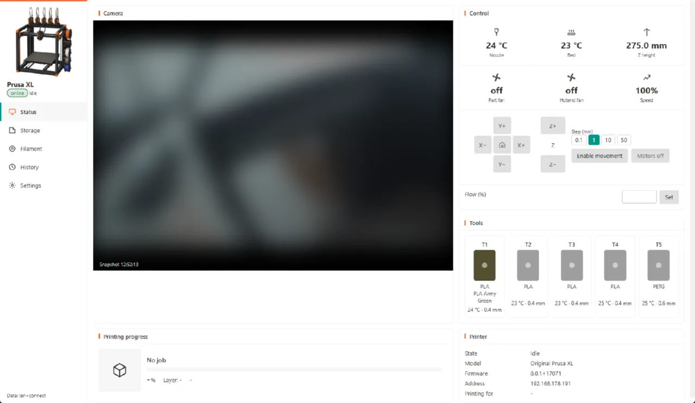
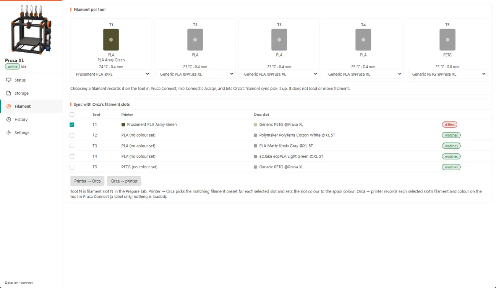
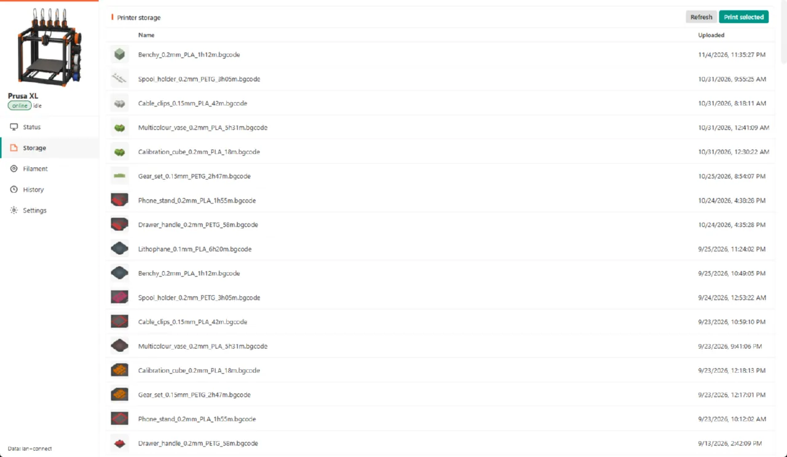
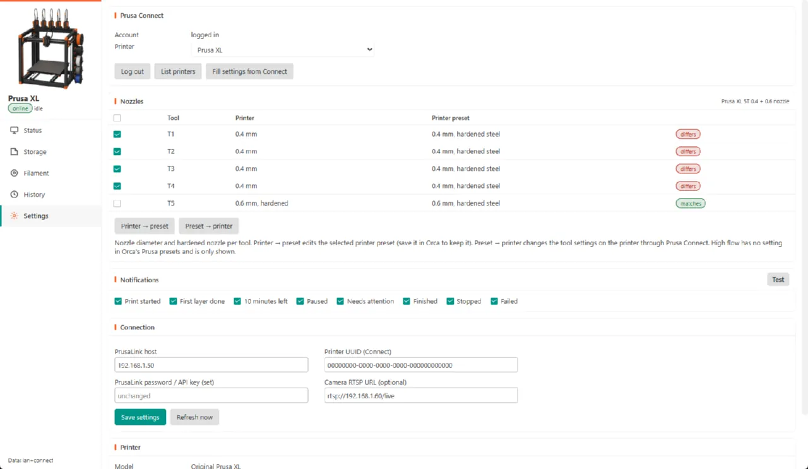

# Prusa for OrcaSlicer

Use your Prusa printer from OrcaSlicer like a Bambu printer: send and print in one click, see status and camera in the Device tab, and keep Orca's filament slots in step with the tools on the printer.



Works with Prusa printers running Buddy firmware: **XL** (1–5 tools), **MK4 / MK4S**, **MK3.5 / MK3.9**, **MINI / MINI+** and **CORE One** (including MMU3 and INDX). Talks to the printer over your network (PrusaLink) and, optionally, through Prusa Connect.

> [!NOTE]
> Very experimental. Needs an OrcaSlicer 2.5 build with Python plugin support. Developed and tested only on a Prusa XL 5T; other models should be supported from Prusa's firmware data but not tested.

[Install](#install) · [What you get](#what-you-get) · [Setup](#set-up-your-printer) · [Safety](#what-the-plugin-will-and-wont-do) · [Troubleshooting](#troubleshooting)

## What you get

**Print from Orca, with a check first.** **Send** and **Print** in Orca upload the plate to the printer over your network. Before anything is sent, the plugin compares the plate with the printer. It warns you when:
- the plate was sliced for another printer model;
- a tool has a different nozzle diameter, or a high-flow or hardened nozzle where the plate expects otherwise;
- the wrong filament is loaded;
- an abrasive filament is on a tool without a hardened nozzle;
- the printer is busy.

**The Device tab works.** Status, progress, temperatures and the camera appear in Orca's Device tab. Pause, resume and stop work from there too.

**Filament sync both ways.** The printer's tools show up as filament slots in Orca. One click sets Orca's slots to what is loaded on the printer, or records Orca's choice on the printer in Prusa Connect.



**Nozzle sync.** Keeps the nozzle diameter and hardened nozzles in step between Orca's printer preset and the printer's tool settings, for each tool.

**A Prusa tab in Orca:**
- **Status:** camera, progress, temperatures, fans, and movement controls behind an "Enable movement" switch.
- **Storage:** the files on the printer, with thumbnails; print one again.
- **Filament:** what is loaded on each tool, and filament sync.
- **History:** every print sent from Orca or started on the printer. It records the result, the time taken, snapshots from the first layer and the end, and the project it came from.
- **Settings:** connection, Prusa Connect login, nozzle sync and notifications.

**Notifications** in Orca when a print starts, finishes the first layer, has 10 minutes left, pauses, needs attention, finishes, stops or fails. You can turn each one off.



It follows Orca's light and dark themes.

## Install

1. Use an OrcaSlicer build with Python plugin support, tested against 2.5RC . It needs the plugin API with the `printer_agent` and `pages` capabilities.
2. Download this repository: **Code → Download ZIP**, or `git clone`.
3. Put the folder in OrcaSlicer's plugin folder as `orca_plugins/prusa`. On Windows:

   ```powershell
   New-Item -ItemType Junction -Path "$env:APPDATA\OrcaSlicer\orca_plugins\prusa" -Target "C:\path\to\orcaslicer-plugin-prusa"
   ```

   On macOS the folder is `~/Library/Application Support/OrcaSlicer/orca_plugins/`; on Linux it is `~/.config/OrcaSlicer/orca_plugins/`.
4. Restart OrcaSlicer and enable **Prusa Integration** in the plugin list. Allow the network access it asks for.

## Set up your printer

The **setup wizard** opens the first time you open the Prusa tab; later you find it under **Settings > Setup wizard**.

1. **Log in to Prusa Connect** in your browser and paste the address the login ends on.
2. **Pick your printer.** The plugin reads its network address, PrusaLink API key and camera from Prusa Connect, so there is nothing to type.
3. **Save and test.** The wizard checks that the printer answers over your network.
4. In Orca's printer preset, select **Prusa (Link + Connect)** as the printer agent. Then pick the printer in the Device tab.

<details>
<summary>No Prusa Connect account? Set up PrusaLink by hand</summary>

In the wizard, choose **Set up PrusaLink by hand** and enter:

- **IP address:** on the printer, open **Settings > Network**.
- **Password:** on the printer, open **Settings > Network > PrusaLink**. Make sure PrusaLink is on; the username is always `maker`.

Without Prusa Connect you get status, upload and print, pause, resume and stop, and the file list. The per-tool filament details, temperature and movement controls, and camera snapshots need Prusa Connect.
</details>

The plugin identifies the model and number of tools on its own. If Orca's selected printer preset is for a different printer, the Prusa tab says so.



## What the plugin will and won't do

- **Prints start only when you ask:** with Orca's **Print** button, or **Print selected** / **Print again**. Each of these asks for confirmation.
- **Movement is off by default.** Turning it on warns you that the camera picture can be seconds old. The printer itself refuses moves while printing.
- **Problems found before sending stop the upload.** Anything that only looks wrong asks you first.
- **A wrong-printer setup disables controls.** If PrusaLink and Prusa Connect point at different printers (their serial numbers differ), the plugin shows an error and turns controls off.
- **Filament sync only changes labels.** It doesn't load, unload or move filament.
- **Your settings stay on your computer:** the PrusaLink password and the Connect login are kept in Orca's plugin data folder.

## Troubleshooting

- **"Prusa Connect is not answering":** status keeps coming from PrusaLink, but tool data and controls may be out of date until Connect answers again.
- **No camera in the Device tab:** the Buddy3D camera only streams over RTSP once you turn that on in its settings. Without RTSP, the plugin shows Connect snapshots, which needs a Connect login.
- **Controls are greyed out:** they need a Connect login, and the printer must accept the command in its current state.
- **Logs:** `prusa_plugin.log` in Orca's `orca_plugins/plugin_data/prusa_plugin/` folder.

Report bugs and ideas in [Issues](https://github.com/thijse/orcaslicer-plugin-prusa/issues).

## Prusa Connect login

The plugin logs in to Prusa Connect with PrusaSlicer's sign-in: log in in the browser, then paste the `prusaslicer://login?code=…` address back into the Prusa tab. This is a stopgap until the plugin has its own sign-in registered with Prusa. Everything except Connect features works without logging in.

## For developers

Any help on making the plugin more robust and feature complete is very welcome. Also testing it with different prusa printers and firmwares.

- **Code layout:** [docs/architecture.md](docs/architecture.md). The core logic is plain Python with tests; only `prusa_orca/app` talks to Orca.
- **Run the tests:** `python -m pytest tests`.
- **Dev scripts:** the scripts in `tools/` drive a running OrcaSlicer through its MCP server. Set `ORCASLICER_SRC` to your OrcaSlicer source folder.

## License

[AGPL-3.0](LICENSE), Not affiliated with or endorsed by Prusa Research; Prusa, PrusaLink and Prusa Connect are trademarks of Prusa Research.
