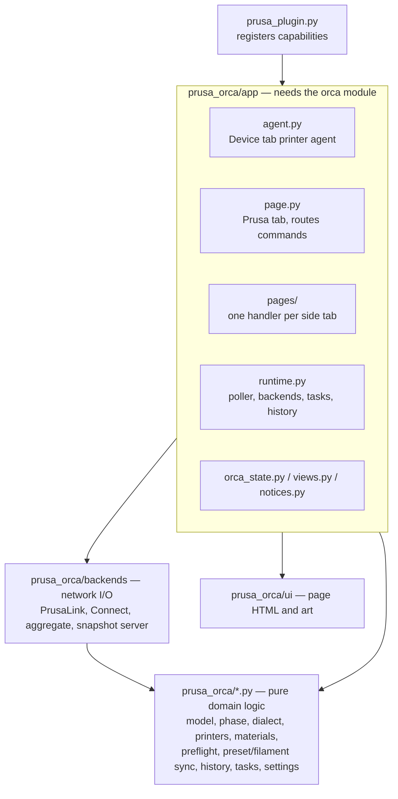

# Architecture

The plugin is split into four layers. A layer only imports from the layers below it. `lint-imports` (contracts in `pyproject.toml`) and `tests/test_layers.py` enforce this, and both run in CI.

| Layer | Rule | Tested by |
| --- | --- | --- |
| Core (`prusa_orca/*.py`) | Pure Python: no `orca`, no network, no threads except `tasks.py`. All decisions live here: what a phase means, which preset matches, what a preflight warns about. | Unit tests with fixtures. |
| Backends (`prusa_orca/backends`) | Talk HTTP to the printer and Prusa Connect, turn answers into core `model` types. No Orca. | Tests with recorded fixtures and a fake HTTP server. |
| UI (`prusa_orca/ui`) | The page HTML/JS and its images. Static; data comes in as JSON messages. | `test_core.TestPagesHtml`. |
| App (`prusa_orca/app`) | The only code that uses `orca`, loaded once in `app/host.py`: Orca presets and dialogs, the printer agent and the tab. Keep it thin; move logic that can be tested without Orca into the core. | `test_app_wiring` with a stub `orca`, plus a live check in Orca. |

The core and backends are type-checked in basedpyright's strict mode, the rest in standard mode. JSON from printers, Connect and settings files is read through `jsonview.py`, which checks types and falls back to defaults instead of raising.

## The Prusa tab

`app/page.py` owns the webview: it sends telemetry, runs work as tasks (busy bar, timeouts, one action per resource) and routes each page command to a handler. Each side tab has a class in `app/pages/` with a `COMMANDS` table mapping a page command to a method:

| Side tab | Handler |
| --- | --- |
| Status | `StatusTab`: poll, refresh, snapshot, job buttons, controls |
| Storage | `StorageTab`: file list, thumbnails, print a stored file |
| Filament | `ToolsTab`: nozzle and filament sync, per-tool material |
| History | `HistoryTab`: records, snapshots, open the project folder |
| Settings | `SettingsTab`: settings, Connect login and printer, notifications |

To add a page command, add it to the handler's `COMMANDS` and write the method; `test_app_wiring` fails if the page sends a command no handler takes.

## Consistency checks

The checks live in the core and the app only feeds them data:

| Check | Where | Effect |
| --- | --- | --- |
| PrusaLink and Connect are different printers (serial from `/api/v1/info` vs Connect `sn`) | `consistency.serial_mismatch`, `AggregateBackend.identity_error` | Red banner; Connect data is dropped, controls and material changes refused, warning in pre-flight |
| Orca's selected printer preset is not for the connected model | `consistency.preset_mismatch` | Notice in the Prusa tab |
| Plate sliced for a non-Prusa printer or another Prusa model | `preflight.check` | Pre-flight warning |
| High-flow preset vs the tool's HF flag (only for models with HF presets in Orca) | `preflight.check`, `GcodeMeta.high_flow` | Pre-flight warning |
| Abrasive filament (`required_nozzle_HRC` > 0 or CF/GF type) on a non-hardened tool | `preflight.check`, `GcodeMeta.abrasive` | Pre-flight warning |
| Printing a stored file again | `preflight.check_reprint` with the history record's metadata | Page asks first, or refuses on a problem |

## Threads

- Orca calls page messages and preset reads on the UI thread. Read Orca state there, then do network work in a task.
- Network calls run on `TaskRunner` workers or the poller thread, never on the UI thread.
- `orca.host.tools` only works from Script workers; pages and the agent can't use it (see [upstream-gaps.md](upstream-gaps.md)).
